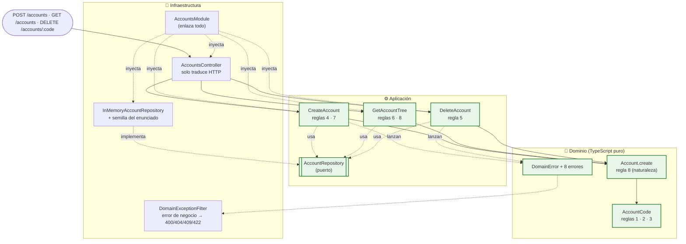

# Núcleo mínimo del backend: qué se hizo

Módulo de catálogo de cuentas (Aravia), carpeta `api/src/accounts/`. Cubre: **crear cuenta**, **consultar el catálogo como árbol** y **eliminar cuenta**.

## 1. Esquema visual

**Cómo leerlo:** las flechas continuas bajan hacia el dominio. Lo que está en verde no importa nada de NestJS. La infraestructura implementa el puerto; la aplicación nunca la conoce.

## 2. Qué se implementó, archivo por archivo

| Capa | Archivo | Qué hace |
|---|---|---|
| Dominio | `domain/account-code.ts` | Value object del código. `parse` acepta solo dígitos, longitud 1/2/4/6 y que no empiece en 0. Calcula `level`, `parentCode` (110505→1105→11→1→null) y `classCode`. |
| Dominio | `domain/account.ts` | `Account.create(code, name, nature?)`: recorta el nombre y rechaza vacío; la clase **exige** naturaleza y los demás niveles la **prohíben**. |
| Dominio | `domain/errors.ts`, `level.ts`, `nature.ts` | `DomainError` con un `kind` por error, nivel por longitud y naturaleza `debit`/`credit`. |
| Aplicación | `ports/account-repository.ts` | Puerto: `save`, `findByCode`, `findAll`, `hasChildren`, `deleteByCode` + token `ACCOUNT_REPOSITORY`. |
| Aplicación | `use-cases/create-account.use-case.ts` | Orden: formato → duplicado (7) → padre existe (4) → guardar. |
| Aplicación | `use-cases/get-account-tree.use-case.ts` | Ordena por código, arma el árbol anidado, hereda la naturaleza de la clase (8) y marca `acceptsMovements` solo en hojas (6). |
| Aplicación | `use-cases/delete-account.use-case.ts` | No existe → 404; tiene hijas → rechaza (5). |
| Infraestructura | `in-memory-account.repository.ts` | `Map` en memoria; `hasChildren` busca cuentas cuyo padre es el código. Incluye `seedAccounts` con el catálogo del enunciado. |
| Infraestructura | `http/accounts.controller.ts` | `POST` → 201, `GET` → árbol, `DELETE` → 204. Solo valida la forma del body. |
| Infraestructura | `http/domain-exception.filter.ts` | Traduce el `kind` del error a HTTP. |
| Infraestructura | `accounts.module.ts` | *Composition root*: enlaza el puerto con el repo y registra los casos de uso con `useFactory`. |
| Pruebas | 6 specs + `test/accounts.e2e-spec.ts` | 57 unitarias y 18 e2e. |

## 3. Qué tecnologías y patrones se usaron

- **NestJS 12** solo en infraestructura: `@Controller`, `@Module`, `@Catch`, `APP_FILTER`. Dominio y aplicación son clases planas.
- **TypeScript ESM** (imports con `.js`), como pide el starter.
- **Vitest + Supertest** para pruebas unitarias y e2e, **oxlint** para el lint. Todo ya venía en el starter; no se instaló nada nuevo.
- **Patrones:** Value Object (`AccountCode`), factory (`Account.create`), puerto/adaptador (repositorio), caso de uso por clase, *composition root* y un único filtro de errores.
- **Repositorio en memoria**, sembrado al arrancar. El starter no trae base de datos.

## 4. Dónde vive cada regla del enunciado

| # | Regla | Dónde |
|---|---|---|
| 1 | Código numérico + nombre | `AccountCode.parse`, `Account.create` |
| 2 | Longitud → nivel | `level.ts`, `AccountCode.level` |
| 3 | Padre = prefijo del nivel anterior | `AccountCode.parentCode` |
| 4 | No crear sin padre | `CreateAccountUseCase` → `ParentNotFoundError` (422) |
| 5 | No eliminar con hijas | `DeleteAccountUseCase` → `AccountHasChildrenError` (409) |
| 6 | Movimientos solo en hojas | `acceptsMovements` calculado en `GetAccountTreeUseCase`, nunca guardado |
| 7 | Código único | `CreateAccountUseCase` → `AccountAlreadyExistsError` (409) |
| 8 | Naturaleza heredada | Solo se guarda en la clase; el árbol la resuelve por `classCode` |

## 5. SOLID en este código

- **S:** un caso de uso por clase; el controller solo traduce HTTP.
- **O:** agregar otro adaptador de persistencia no toca dominio ni casos de uso.
- **L:** el repo falso de los tests y el repo en memoria cumplen el mismo puerto y son intercambiables.
- **I:** el puerto tiene solo las 5 operaciones que los casos de uso necesitan.
- **D:** los casos de uso reciben `AccountRepository` por constructor; el módulo decide la implementación.

## 6. Contrato HTTP

| Método | Ruta | Éxito | Errores |
|---|---|---|---|
| `POST` | `/accounts` `{ code, name, nature? }` | 201 + nodo creado | 400 formato/nombre/naturaleza · 409 duplicado · 422 padre inexistente |
| `GET` | `/accounts` | 200 + árbol anidado | — |
| `DELETE` | `/accounts/:code` | 204 | 404 no existe · 409 tiene hijas |

Cada nodo del árbol: `{ code, name, level, nature, acceptsMovements, children[] }`.

## 7. Cosas a tener en cuenta

- El código `0` se rechaza; el `3` es una clase válida de un dígito.
- Las clases con hijas **no** admiten movimientos; al borrar la última hija, el padre vuelve a admitirlos.
- `fake-account-repository.ts` está junto a los casos de uso porque lo comparten los specs. Es código de pruebas y podría moverse.
- Pendiente: quitar el Hello World del starter y escribir el README final (tarea 4), y la pantalla.
