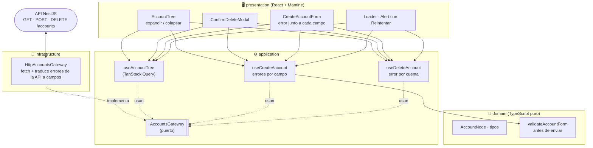
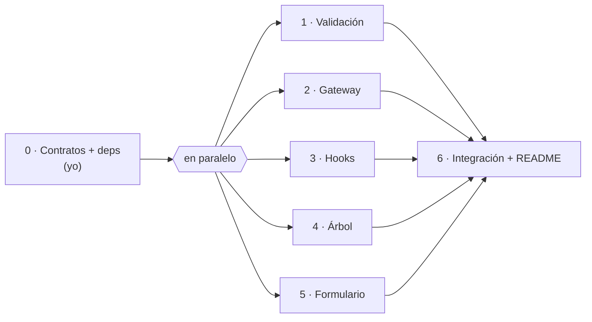

# Plan del frontend: catálogo de cuentas

> Estado: **propuesta para aprobar, sin código todavía.** Misma estructura que el backend (Clean Architecture + SOLID).

## 1. Qué hay que construir (núcleo mínimo)

1. Pantalla con el catálogo como árbol, con expandir y colapsar.
2. Formulario para crear una cuenta, con validación antes de enviar y con los errores de la API visibles junto al campo que corresponda.
3. Eliminar una cuenta desde el árbol, con confirmación, mostrando el error cuando tiene hijas.
4. Estados de carga y de error en las dos operaciones. Nada de pantallas en blanco ni errores solo en consola.
5. README corto (ver sección 6).

## 2. Esquema

Las flechas apuntan hacia adentro. Los componentes no llaman a `fetch`; los hooks no conocen HTTP; el dominio no importa ninguna librería.

## 3. Librerías (libres, y qué resuelve cada una)

| Librería | Capa | Qué me resuelve | Qué evita escribir a mano |
|---|---|---|---|
| **Mantine** (`@mantine/core`, `@mantine/hooks`) | presentation | Componentes accesibles ya hechos: `Tree` (árbol expandible), `Modal` (confirmación), `TextInput`/`Select` con prop `error` (error junto al campo), `Loader`, `Alert`, `Button`. | Árbol con teclado y ARIA, modal con foco atrapado, estilos de error. |
| **@mantine/form** | presentation | Estado del formulario y mostrar errores por campo. Recibe mi función `validateAccountForm`, que queda en el dominio y se prueba aparte. | Manejo de `values`/`errors`/`touched`. |
| **TanStack Query** (`@tanstack/react-query`) | application | Estado de servidor: `loading`, `error`, reintento y recarga del árbol tras crear o eliminar (`invalidateQueries`). | `useEffect` + `useState` con carreras, reintentos y refetch manual. |
| **Vitest** (solo desarrollo) | pruebas | Probar la validación y el mapeo de errores de la API. Es el runner que ya usa `api/`. | — |

No se agrega router, gestor de estado global ni librería de iconos. El núcleo no los necesita.

## 4. Cómo se cubre cada requisito

| # | Requisito | Dónde |
|---|---|---|
| 1 | Árbol con expandir y colapsar | `AccountTree` (Mantine `Tree`) |
| 2 | Formulario con validación previa y errores de la API junto al campo | `validateAccountForm` + `CreateAccountForm`. El gateway convierte el error en campo: `invalid_account_code`, `account_already_exists`, `parent_not_found` → **code**; `invalid_account_name` → **name**; `nature_required`, `nature_not_allowed` → **nature**. |
| 3 | Eliminar con confirmación y error si hay hijas | `ConfirmDeleteModal`. El botón **no** se deshabilita: la API responde 409 y el mensaje se muestra en la cuenta. |
| 4 | Estados de carga y error | `Loader` y `Alert` con "Reintentar" al cargar; "enviando" y "eliminando" en las mutaciones. |
| 5 | README corto | Se reescribe al final. |

La validación del formulario repite las reglas 1 y 2 (solo dígitos, largo 1/2/4/6, sin `0` inicial; nombre no vacío; naturaleza obligatoria en clases y prohibida en el resto). La existencia del padre y la unicidad las decide solo la API.

## 5. Tareas

| # | Tarea | Archivos (`web/src/features/accounts/`) | Depende de |
|---|---|---|---|
| 0 | **Contratos + dependencias:** instalar Mantine, TanStack Query y Vitest; tipos, puerto `AccountsGateway`, `ApiError` con su campo, firmas de los 3 hooks y providers en `main.tsx` | `domain/account.ts`, `application/accounts-gateway.ts` | — |
| 1 | **Validación del formulario** + tests | `domain/validate-account-form.ts` | 0 |
| 2 | **Gateway HTTP:** fetch, mapeo de errores a campos + tests, y ampliar `api.ts` | `infrastructure/http-accounts-gateway.ts` | 0 |
| 3 | **Hooks de aplicación** sobre TanStack Query | `application/use-*.ts` | 0 |
| 4 | **Árbol y eliminar:** `AccountTree`, `ConfirmDeleteModal`, vistas de carga y error | `presentation/` | 0 |
| 5 | **Formulario y `App`:** `CreateAccountForm`, composición en `App.tsx` | `presentation/`, `App.tsx` | 0 |
| 6 | **Integración:** README corto, verificación en el navegador de los 5 requisitos, diff para revisión | — | 1–5 |

Contratos de los hooks, que fijan las tareas 3, 4 y 5:

- `useAccountTree()` → `{ status, nodes, error, reload }`
- `useCreateAccount(onCreated)` → `{ submit, submitting, fieldErrors, formError }`
- `useDeleteAccount(onDeleted)` → `{ remove, deletingCode, error }`

**Commits:** uno por tarea (0 a 6), para que se vea el orden en que se avanzó.

## 6. Entrega (lo que pide la prueba)

- Repositorio **público**, creado desde el template de GitHub (o clonado y subido a tu cuenta).
- **Enlace pegado en la plataforma apenas se cree**, no al final.
- `README.md` **corto**, que reemplaza al del arranque, con: cómo se corre, qué decisiones se tomaron, qué se dejó afuera y qué se haría con más tiempo.
- **Commits a lo largo de la prueba**, no uno solo al final.

> El `README.md` actual es largo porque documenta el backend en detalle. En la tarea 6 se acorta a lo que pide la entrega y el detalle queda en `BACKEND-NUCLEO.md` y en este plan.
