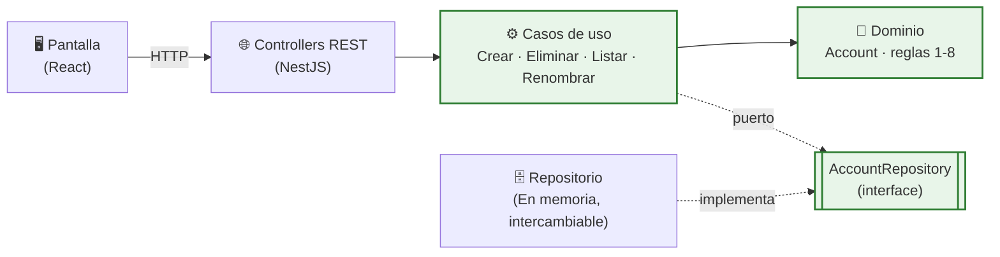

# Plan: Módulo Catálogo de Cuentas (Aravia)

> Estado: **propuesta, sin código todavía**. Al aprobarlo se implementa paso a paso y cada paso queda documentado en `README.md`.

## 1. Esquema de 10 segundos



**Regla única:** las flechas sólidas apuntan hacia adentro. El dominio no importa nada; la infraestructura depende de un puerto, nunca al revés.

## 2. Capas (Clean Architecture)

| Capa | Contiene | Depende de |
|---|---|---|
| **Dominio** | `Account`, `AccountCode` (VO), `Level`, `Nature`, errores de dominio | nada |
| **Aplicación** | Casos de uso + puerto `AccountRepository` | dominio |
| **Infraestructura** | Repositorio concreto, controllers NestJS, `AccountsModule` (DI y composition root) | aplicación |

**NestJS:** el dominio y la aplicación son TypeScript puro, sin decoradores de Nest. Solo la infraestructura usa `@Controller`, `@Module` e `@Injectable`. El puerto se inyecta con un token (`ACCOUNT_REPOSITORY`) y el `AccountsModule` enlaza el token con la implementación concreta. Los casos de uso se registran con `useFactory`, así no dependen del framework.
| **Presentación** | Pantalla React + cliente de la API | solo contrato HTTP |

## 3. Las 8 reglas: dónde vive cada una

| # | Regla | Dónde | Cómo |
|---|---|---|---|
| 1 | Código numérico + nombre | Dominio | `AccountCode` valida solo dígitos; nombre no vacío |
| 2 | Longitud → nivel | Dominio | `AccountCode.level` (1=Clase, 2=Grupo, 4=Cuenta, 6=Subcuenta); otra longitud ⇒ error |
| 3 | Padre = prefijo del nivel anterior | Dominio | `AccountCode.parentCode` (`110505 → 1105 → 11 → 1`) |
| 4 | No crear sin padre | Aplicación | `CreateAccount` consulta el repo y lanza `ParentNotFound` |
| 5 | No eliminar con hijas | Aplicación | `DeleteAccount` usa `hasChildren` y lanza `AccountHasChildren` |
| 6 | Movimientos solo en hojas | Dominio/Aplicación | `acceptsMovements = !hasChildren`, calculado, **nunca almacenado** |
| 7 | Código único | Aplicación + repo | `CreateAccount` verifica; el repo además lo garantiza (clave primaria) |
| 8 | Naturaleza heredada de la clase | Dominio | Solo se guarda en la Clase; los demás la resuelven por su primer dígito |

Decisión clave: **nivel, padre y naturaleza se derivan del código**, no se guardan. Así no pueden quedar incoherentes.

## 4. SOLID aplicado

- **S** — un caso de uso = una clase = una razón de cambio. Controllers solo traducen HTTP ⇄ DTO.
- **O** — nuevos niveles o reglas se agregan como estrategia/regla, sin tocar los casos de uso existentes.
- **L** — `InMemoryAccountRepository` y `SqliteAccountRepository` son intercambiables sin que los casos de uso lo noten (mismos tests de contrato para ambos).
- **I** — puertos pequeños: lectura (`AccountReader`) y escritura (`AccountWriter`) separados si algún caso de uso solo lee.
- **D** — los casos de uso reciben el repositorio por constructor; el ensamblado ocurre en un único *composition root*.

## 5. API REST

| Método | Ruta | Caso de uso | Errores |
|---|---|---|---|
| `GET` | `/accounts` | Listar árbol completo | — |
| `GET` | `/accounts/:code` | Detalle (nivel, padre, naturaleza, `acceptsMovements`) | 404 |
| `POST` | `/accounts` | Crear (`code`, `name`, `nature` solo si es Clase) | 400 código inválido · 404/422 padre no existe · 409 código duplicado |
| `PATCH` | `/accounts/:code` | Renombrar (el código es inmutable) | 404 |
| `DELETE` | `/accounts/:code` | Eliminar | 404 · 409 tiene hijas |

Los errores de dominio se mapean a HTTP en **un solo** `ExceptionFilter` de NestJS (infraestructura), no en los casos de uso. Los DTOs de entrada se validan con `class-validator` y `ValidationPipe`, y se documentan con Swagger (`@nestjs/swagger`).

## 6. Pantalla

- Árbol expandible/colapsable con código, nombre, nivel y naturaleza.
- Botón "Agregar hija" en cada nodo (el padre ya viene fijado; el nivel se deduce).
- Crear clase: formulario con naturaleza (débito/crédito).
- Eliminar deshabilitado si tiene hijas, con el motivo visible.
- Badge "Admite movimientos" en las hojas.
- Mensajes de error de la API mostrados tal cual, sin lógica de negocio duplicada en el front.

## 7. Estructura de carpetas

Se parte del proyecto que ya existe (`tech-assessment-starter-fullstack`): `api/` es NestJS y `web/` es React + Vite. No se crea nada desde cero; se organiza lo que hay.

```
api/src/
  accounts/
    domain/           account.ts · account-code.ts · nature.ts · errors.ts
    application/      ports/account-repository.ts · use-cases/{create,delete,list,rename}-account.ts
    infrastructure/   in-memory-account.repository.ts · http/{accounts.controller,dto,domain-exception.filter}.ts · accounts.module.ts
  app.module.ts       (importa AccountsModule; se elimina el Hello World)
  main.ts             (ya existe; se agrega ValidationPipe y Swagger)
web/src/
  api.ts              (ya existe; se amplía como cliente HTTP)
  features/accounts/  AccountTree.tsx · AccountForm.tsx
  App.tsx             (se reemplaza la pantalla de prueba de conexión)
  api/ · features/accounts/{AccountTree,AccountForm}.tsx
README.md           ← bitácora paso a paso
```

## 8. Pasos de implementación (cada uno cierra con su sección en el README)

1. **Preparar el starter** — verificar que `npm install` y `npm run dev` funcionan (Node 22, npm 10+), borrar el Hello World (`app.controller`, `app.service`) y la pantalla de prueba, crear la carpeta `accounts/` con sus capas y reemplazar el README del starter por el nuestro. *README: cómo instalar y correr.*
2. **Dominio** — `AccountCode`, `Account`, `Nature`, errores + tests unitarios de reglas 1, 2, 3, 6, 8 (TDD). *README: glosario y reglas.*
3. **Puerto + casos de uso** — `AccountRepository`, los 4 casos de uso con repositorio en memoria; tests de reglas 4, 5, 7. *README: diagrama de capas y contrato del puerto.*
4. **Infraestructura** — repositorio en memoria como implementación principal, con tests de contrato reutilizables por cualquier otra implementación futura. *README: decisión de persistencia y qué haríamos con más tiempo.*
5. **API HTTP** — controllers, DTOs, `ExceptionFilter`, Swagger, tests e2e con Supertest; semilla con el catálogo de ejemplo. *README: tabla de endpoints con ejemplos `curl`.*
6. **Pantalla** — árbol, formularios, manejo de errores. *README: capturas y flujo de uso.*
7. **Cierre** — verificación de las 8 reglas de extremo a extremo y revisión SOLID. *README: checklist final.*

## 9. Supuestos (dime si alguno no aplica)

- **Stack (ya dado por el starter):** NestJS 12 en `api/` y React 19 + Vite en `web/`, TypeScript, módulos ESM (los imports llevan `.js`), pruebas con Vitest + Supertest y lint con oxlint. No se agrega nada que el starter ya cubra.
- **Persistencia:** el starter no trae base de datos, así que empiezo con un repositorio **en memoria**, sembrado con el catálogo de ejemplo. El puerto permite cambiarlo por SQL sin tocar dominio ni casos de uso. Si quieres base de datos real desde ya, dímelo.
- **Naturaleza:** solo se pide al crear una Clase; se rechaza si se envía en niveles inferiores.
- **Código:** solo dígitos, sin ceros a la izquierda en la clase (`0` no es clase válida).
- **Renombrar sí, recodificar no:** cambiar un código rompería la jerarquía de sus descendientes.
- **Eliminar clase raíz sin hijas** está permitido (regla 5 es la única restricción).
