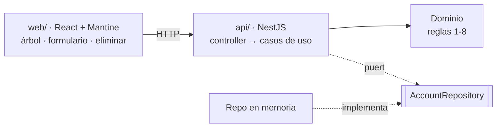

# Catálogo de cuentas — Aravia

Módulo que administra el catálogo jerárquico de cuentas (Clase → Grupo → Cuenta → Subcuenta): API en NestJS y pantalla en React.



## Cómo se corre

Requisitos: Node 22 (`.nvmrc`) y npm 10 o superior.

```bash
npm install     # instala raíz, api/ y web/
npm run dev     # API en :3000 y web en :5173
```

Abre http://localhost:5173. El catálogo arranca con el ejemplo del enunciado.

| Script | Qué hace |
|---|---|
| `npm test` | Pruebas unitarias de `api/` y `web/` (Vitest) |
| `npm run test:e2e --prefix api` | Pruebas e2e de la API |
| `npm run lint` · `npm run build` | Lint y compilación de los dos |

API: `GET /accounts` (árbol anidado), `POST /accounts` `{ code, name, nature? }`, `DELETE /accounts/:code`. Los errores salen como `{ statusCode, error, message }`.

## Demo

**[Ver la demo (GIF en Google Drive)](https://drive.google.com/file/d/1oXCFJn7lBcOrZUuK1hCixrR1PRiNhPRx/view?usp=sharing)**

Recorrido de las pruebas en la pantalla: expandir el árbol, crear una cuenta, el error de la API junto al campo cuando el padre no existe, eliminar con confirmación y el error al eliminar una cuenta con hijas.

## Decisiones

- **Clean Architecture y SOLID en las dos mitades** (`domain` → `application` → `infrastructure` → `presentation`). Las reglas viven en el dominio y los casos de uso; el controller solo traduce HTTP.
- **Nivel, padre y naturaleza se derivan del código**, no se guardan, así no pueden quedar incoherentes. `acceptsMovements` se calcula al consultar.
- **La API es la fuente de verdad.** El front valida antes de enviar (formato y naturaleza) solo para dar respuesta rápida; la existencia del padre y la unicidad las decide el servidor, y su error se muestra junto al campo que corresponde.
- **Errores de negocio con un `kind` propio**, traducidos a 400, 404, 409 o 422 en un único filtro. El gateway del front los convierte al campo del formulario.
- **Librerías del front:** Mantine (componentes accesibles, modal y campos con error), `@mantine/form` (estado del formulario) y TanStack Query (carga, error, reintento y recarga del árbol tras crear o eliminar). Mantine solo vive en `presentation` y TanStack Query en `application`.
- **Árbol propio y recursivo** en lugar del `Tree` de Mantine, para controlar `aria-expanded` y el botón de eliminar por fila.
- **Persistencia en memoria**: el starter no trae base de datos. Gracias al puerto, cambiarla no toca dominio ni casos de uso.

## Qué dejé afuera

- Base de datos: al reiniciar la API se pierde lo creado.
- Renombrar o mover cuentas (el código es inmutable a propósito) y un botón "Agregar hija" que precargue el prefijo.
- Pruebas de los hooks y de los componentes (el runner de `web/` no tiene DOM); hay pruebas de validación y del gateway.
- Swagger, autenticación y paginación.

## Qué haría con más tiempo

- Un adaptador SQL del repositorio con las mismas pruebas de contrato que el de memoria.
- Pruebas de componentes con Testing Library y un recorrido e2e con Playwright.
- Renombrar cuentas y movimientos contables sobre las hojas (regla 6).
- Documentar la API con OpenAPI y compartir los tipos con el front.
- CI con lint, pruebas y build.

## Más detalle

El paso a paso de cada commit está en [docs/BITACORA.md](./docs/BITACORA.md). También hay [el detalle del backend](./docs/BACKEND-NUCLEO.md), [el plan del frontend](./docs/FRONTEND-PLAN.md) y [el plan inicial](./docs/PLAN.md).
