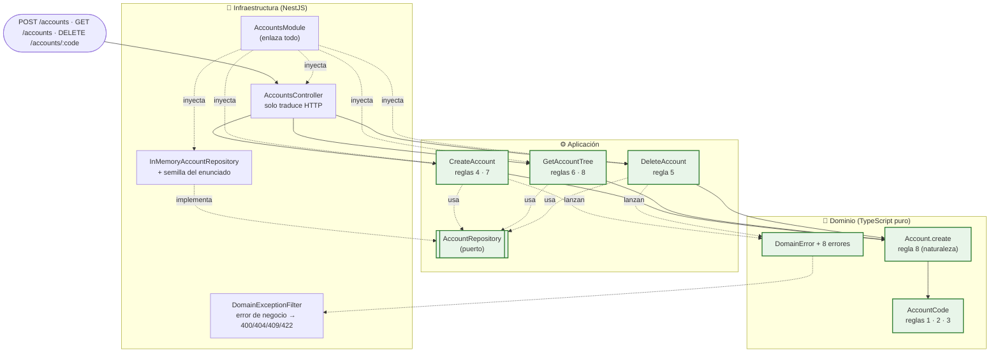

# Catálogo de cuentas — Aravia

Módulo que administra el catálogo de cuentas de un software contable: lista jerárquica de cuentas (Clase → Grupo → Cuenta → Subcuenta) con API y pantalla.

| Carpeta | Qué hay | Puerto | Estado |
|---------|---------|:------:|--------|
| `api/` | NestJS 12 + TypeScript, con Clean Architecture | 3000 | ✅ Núcleo listo |
| `web/` | React 19 + Vite + TypeScript + Mantine + TanStack Query | 5173 | 🚧 En construcción (ver bitácora del frontend) |

## Cómo correrlo

Requisitos: **Node 22** (`.nvmrc`) y **npm 10 o superior**.

```bash
npm install     # instala la raíz, api/ y web/
npm run dev     # levanta api y web a la vez
```

| Script | Qué hace |
|--------|----------|
| `npm run dev` / `dev:api` / `dev:web` | Levanta los dos, solo la API o solo el front |
| `npm test` | Pruebas unitarias de la API (Vitest) |
| `npm run test:e2e --prefix api` | Pruebas e2e de la API (Vitest + Supertest) |
| `npm run lint` | oxlint en los dos |
| `npm run build` | Compila los dos |

> Mientras no se construya la pantalla, `web/` sigue mostrando la página de comprobación del starter, que consulta `GET /` y ahora responde 404 porque se eliminó el Hello World. Es esperado.

## Las reglas del negocio

1. Cada cuenta tiene un código numérico y un nombre.
2. La longitud del código define el nivel: 1 Clase · 2 Grupo · 4 Cuenta · 6 Subcuenta.
3. El padre es la cuenta cuyo código es su prefijo en el nivel anterior (`110505 → 1105 → 11 → 1`). Las clases no tienen padre.
4. No se crea una cuenta si su padre no existe.
5. No se elimina una cuenta que tenga hijas.
6. Solo las cuentas sin hijas admiten movimientos contables.
7. El código es único.
8. Cada clase tiene naturaleza (débito/crédito) y sus descendientes la heredan.

## Arquitectura del backend

Clean Architecture con SOLID. Las dependencias apuntan hacia adentro: el dominio no importa nada; la infraestructura implementa un puerto definido por la aplicación.



Lo verde no importa nada de NestJS.

### Estructura de carpetas

```
api/src/
  accounts/
    domain/          account-code.ts · account.ts · level.ts · nature.ts · errors.ts
    application/     dto.ts · ports/account-repository.ts · use-cases/{create,get-account-tree,delete}-account.use-case.ts
    infrastructure/  in-memory-account.repository.ts · accounts.module.ts · http/{accounts.controller,domain-exception.filter}.ts
  app.module.ts      importa AccountsModule
  main.ts            bootstrap + CORS hacia el front
api/test/            accounts.e2e-spec.ts
```

### Dónde vive cada regla

| # | Regla | Dónde |
|---|---|---|
| 1 | Código numérico + nombre | `AccountCode.parse`, `Account.create` |
| 2 | Longitud → nivel | `level.ts`, `AccountCode.level` |
| 3 | Padre = prefijo | `AccountCode.parentCode` |
| 4 | No crear sin padre | `CreateAccountUseCase` → `ParentNotFoundError` (422) |
| 5 | No eliminar con hijas | `DeleteAccountUseCase` → `AccountHasChildrenError` (409) |
| 6 | Movimientos solo en hojas | `acceptsMovements`, calculado al consultar, nunca guardado |
| 7 | Código único | `CreateAccountUseCase` → `AccountAlreadyExistsError` (409) |
| 8 | Naturaleza heredada | Solo se guarda en la clase; el árbol la resuelve por `classCode` |

**Decisión clave:** nivel, padre y naturaleza **se derivan del código**, no se almacenan. Así no pueden quedar incoherentes.

## API

| Método | Ruta | Éxito | Errores |
|---|---|---|---|
| `POST` | `/accounts` con `{ code, name, nature? }` | 201 + nodo creado | 400 formato, nombre o naturaleza · 409 duplicado · 422 padre inexistente |
| `GET` | `/accounts` | 200 + árbol anidado | — |
| `DELETE` | `/accounts/:code` | 204 | 404 no existe · 409 tiene hijas |

`nature` (`debit` o `credit`) es **obligatoria en las clases y se rechaza en los demás niveles**. Cada nodo del árbol es `{ code, name, level, nature, acceptsMovements, children[] }`. Los errores salen como `{ statusCode, error, message }`.

### Ejemplos (respuestas reales)

```bash
# Árbol completo (arranca con el catálogo de ejemplo del enunciado)
curl http://localhost:3000/accounts

# Crear una subcuenta
curl -X POST http://localhost:3000/accounts -H "Content-Type: application/json" \
  -d '{"code":"110515","name":"Caja de prueba"}'
# 201 {"code":"110515","name":"Caja de prueba","level":"subaccount","nature":"debit","acceptsMovements":true,"children":[]}

# Padre inexistente
curl -X POST http://localhost:3000/accounts -H "Content-Type: application/json" \
  -d '{"code":"990505","name":"Sin padre"}'
# 422 {"statusCode":422,"error":"parent_not_found","message":"No se puede crear 990505: el padre 9905 no existe."}

# Eliminar con hijas
curl -X DELETE http://localhost:3000/accounts/11
# 409 {"statusCode":409,"error":"account_has_children","message":"La cuenta 11 tiene cuentas hijas y no se puede eliminar."}

# Eliminar una hoja
curl -X DELETE http://localhost:3000/accounts/110515
# 204
```

## SOLID

- **S:** un caso de uso por clase; el controller solo traduce HTTP.
- **O:** otro adaptador de persistencia no toca dominio ni casos de uso.
- **L:** el repositorio falso de los tests y el repositorio en memoria cumplen el mismo puerto.
- **I:** el puerto tiene solo las 5 operaciones que los casos de uso necesitan.
- **D:** los casos de uso reciben `AccountRepository` por constructor; el módulo decide la implementación.

## Bitácora: qué se hizo en cada paso

| Paso | Qué se hizo | Resultado |
|---|---|---|
| 0 · Contratos | Tipos de dominio (`Nature`, `Level`, errores), `Account`, esqueleto de `AccountCode`, puerto `AccountRepository` y DTOs | Firmas fijas para trabajar en paralelo. Commit `0499e6f`. |
| 1 · Dominio | `AccountCode` real (solo dígitos, longitud 1/2/4/6, sin `0` inicial; nivel, padre y clase) y `Account.create` (nombre y naturaleza) | 40 tests. Reglas 1, 2, 3 y 8. |
| 2 · Casos de uso | Crear (formato → duplicado → padre), consultar árbol (herencia de naturaleza, `acceptsMovements`) y eliminar | 16 tests con repositorio falso. Reglas 4, 5, 6, 7. |
| 3 · Infraestructura | Repositorio en memoria con semilla, controller, filtro de errores, `AccountsModule` y e2e | 17 tests e2e. API funcionando. |
| 4 · Limpieza y docs | Eliminado el Hello World (`AppController`, `AppService`, su spec y su e2e), `AppModule` solo importa `AccountsModule`, README reescrito | `tsc` y lint limpios; 56 unitarias y 17 e2e pasan; API probada en vivo. |

Para el detalle archivo por archivo, ver [BACKEND-NUCLEO.md](./BACKEND-NUCLEO.md). El plan original está en [PLAN.md](./PLAN.md).

### Bitácora del frontend

Plan completo y esquema en [FRONTEND-PLAN.md](./FRONTEND-PLAN.md). Misma arquitectura por capas que el backend: `domain` → `application` → `infrastructure` → `presentation`, en `web/src/features/accounts/`.

| Paso | Qué se hizo | Resultado |
|---|---|---|
| F0 · Contratos y dependencias | Se instalaron **Mantine** (componentes accesibles: árbol, modal, campos con error), **@mantine/form** (estado del formulario), **TanStack Query** (carga, error y recarga) y **Vitest** (pruebas). Se fijaron los tipos (`AccountNode`, `FieldErrors`), el error `AccountsApiError` (con el campo al que pertenece), el puerto `AccountsGateway`, las firmas de los 3 hooks y los providers en `main.tsx`. | Contratos fijos para trabajar en paralelo. Las funciones aún lanzan "Pendiente" hasta las tareas 1 a 3. |

### Cómo se trabajó

Los pasos 1, 2 y 3 se ejecutaron en paralelo sobre archivos distintos, contra los contratos del paso 0, y se integraron y verificaron al final.

## Decisiones y lo que quedó fuera

- **Persistencia en memoria:** el starter no trae base de datos. El repositorio se siembra al arrancar y los datos se pierden al reiniciar. Gracias al puerto, pasar a SQL solo requiere un nuevo adaptador.
- **Sin `class-validator` ni Swagger:** el dominio ya valida el significado de los datos; el controller solo comprueba la forma del body. Se evitó instalar dependencias nuevas.
- **El código no se edita:** cambiar un código rompería la jerarquía de sus descendientes. Renombrar no está implementado todavía.
- **El código `0` se rechaza;** `3` es una clase válida de un dígito.
- **`fake-account-repository.ts`** vive junto a los casos de uso porque lo comparten los specs; es código de pruebas.

### Pendiente

- Pantalla en `web/` (árbol, crear, eliminar, errores visibles).
- Con más tiempo: persistencia real, renombrar cuentas, documentación con Swagger y concurrencia en el repositorio.
